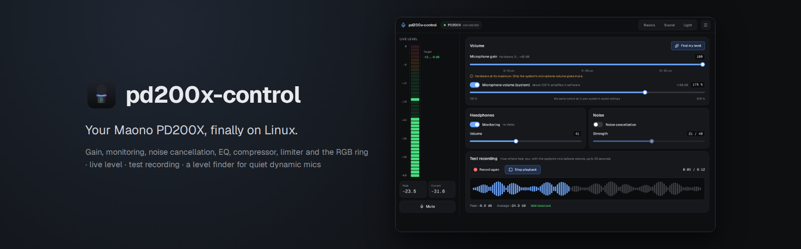

<div align="center">



**The Maono PD200X and PD200XS on Linux – a MAONO Link alternative for gain, EQ and the RGB ring light.**<br>
Set everything MAONO Link sets, see your live level, hear yourself as others hear you.<br>
Finds the right level for a quiet dynamic microphone in five seconds. Free, open source, written in Rust.

[](https://github.com/firsttris/pd200x-control/actions/workflows/ci.yml)
[](https://github.com/firsttris/pd200x-control/releases/latest)
[](https://github.com/firsttris/pd200x-control/releases)
[](https://firsttris.github.io/pd200x-control/)
[](LICENSE)<br>
[](https://firsttris.github.io/pd200x-control/faq.html#does-it-work-with-the-pd200xs)
[](https://firsttris.github.io/pd200x-control/installation.html)
[](https://www.rust-lang.org/)
[](https://tauri.app/)
[](https://www.typescriptlang.org/)

[Why](#-why-pd200x-control) •
[Install](#-install) •
[Features](#-features) •
[Screenshots](#-screenshots) •
[FAQ](#-faq) •
[Documentation](https://firsttris.github.io/pd200x-control/) •
[Development](#️-development)


</div>

## 💡 Why pd200x-control?

The PD200X and PD200XS are popular USB/XLR dynamic microphones, but MAONO Link, the app that sets
their EQ, noise cancellation and RGB light, runs on Windows only. On Linux the microphone works, but
it is quiet, and its settings are out of reach.

- **Every setting, on Linux.** Gain, mute, headphone monitoring, noise cancellation, the eight EQ
  profiles, a 7-band parametric EQ, compressor, limiter and the ring light – the same things MAONO Link
  sets, through the same USB protocol.
- **A quiet microphone, solved.** Dynamic microphones are quiet over USB even at full gain. The live
  meter shows where your voice peaks, the system microphone volume goes up to 200 %, and **Find my
  level** sets gain and volume from five seconds of speech.
- **Hear what others hear.** The test recording comes from PipeWire, with the system volume in it –
  exactly what Discord, OBS or a browser get. The microphone's own monitoring cannot show you that.
- **Shows the real state.** The app reads the settings from the microphone when it is plugged in and
  recognises the active EQ profile. The microphone keeps everything itself; close the app when you
  are done.

Start the desktop app with `--hidden` to keep it in the tray at login. Open its window later
from the tray or the normal application launcher; a second `--hidden` launch stays in the background.

Runs on any Linux with PipeWire – Fedora, Ubuntu, Debian, Arch, openSUSE, Bazzite – under KDE, GNOME
or any other desktop.

## 🚀 Install

Download from the [latest release](https://github.com/firsttris/pd200x-control/releases/latest):

```sh
# Debian, Ubuntu, Mint (installs the udev rule)
sudo apt install ./pd200x-control_*_amd64.deb

# Fedora, openSUSE (installs the udev rule)
sudo dnf install ./pd200x-control-*.x86_64.rpm

# Any distribution: the Flatpak or the AppImage, plus the udev rule once
curl -LO https://raw.githubusercontent.com/firsttris/pd200x-control/main/packaging/99-pd200x.rules
sudo cp 99-pd200x.rules /etc/udev/rules.d/ && sudo udevadm control --reload-rules && sudo udevadm trigger
flatpak install --user ./pd200x-control_*_x86_64.flatpak   # or: chmod +x and run the .AppImage
```

Plug the microphone in (again) and the app finds it. The command line tool `pd200x` is in the
release too. Everything else is in the
[installation guide](https://firsttris.github.io/pd200x-control/installation.html).

## ✨ Features

### 🎚️ Level

- **Live level meter** in dBFS with the target zone for speech (−12 to −6 dB) and the peak.
- **Microphone gain** with MAONO's distance hints, **mute** like the button on the microphone.
- **System microphone volume** up to 200 % – the same control as your desktop's sound settings.
- **Protect from apps**: Teams, Slack and browsers can no longer turn it down in a call.
- **Find my level**: five seconds of speech, a proposal for gain and volume, applied when you agree.
- **Test recording** up to 30 seconds with waveform, peak, average and a verdict.

### 🎛️ Sound

- **The eight MAONO profiles** (Flat, Low cut, Mid boost, Bright, Natural, Classic, Deep, …) with
  their curves, plus **your own profiles**.
- **7-band EQ** drawn as the microphone applies it: drag a band, scroll for Q, or type exact values;
  high-pass and low-pass filters.
- **Compressor** and **limiter** with their thresholds in dB.
- **Headphone monitoring** and volume, **noise cancellation** and its strength.

### 🌈 Light

- **Ring light** on or off, **nine colours** including rainbow, **brightness**.
- **Light off while muted**: see at a glance whether people can hear you.

### 🧰 Everything else

- **Reads the microphone** on connect and detects the active profile; plug it in at any time.
- **Command line**: `pd200x status`, `pd200x eq natural`, `pd200x light cyan`, `pd200x calibrate`, …
- **Tray** with mute, **German and English**, light and dark theme.
- **No daemon, no cloud, no account.** Talks to the microphone through hidraw, no driver needed.

## 📸 Screenshots

<table>
  <tr>
    <td></td>
    <td></td>
  </tr>
  <tr>
    <td></td>
    <td></td>
  </tr>
</table>

## ❓ FAQ

### Is there a Linux version of MAONO Link?
No – MAONO Link is Windows only. pd200x-control is an independent app that sets the same things on
Linux through the same USB protocol. Firmware updates still need MAONO Link.

### Why is my Maono PD200X so quiet on Linux?
Because it is a dynamic microphone; over USB it is quiet on every system. Speak close into the top,
set the gain to 100 and raise the system microphone volume above 100 % – or press **Find my level**.
More in [A quiet microphone](https://firsttris.github.io/pd200x-control/quiet-microphone.html).

### Does it work with the PD200XS?
Yes. The PD200X and PD200XS have the same USB id (`352f:0104`) and the same settings.

### Does the app have to keep running?
No. The microphone stores its settings itself, and WirePlumber keeps the system volume.

More answers and troubleshooting: [FAQ](https://firsttris.github.io/pd200x-control/faq.html).

## 📚 Documentation

The full documentation, with search, is at **[firsttris.github.io/pd200x-control](https://firsttris.github.io/pd200x-control/)**.

| | |
|---|---|
| [Installation](https://firsttris.github.io/pd200x-control/installation.html) | AppImage, .deb, .rpm, Flatpak, the CLI, the udev rule, building from source |
| [The app](https://firsttris.github.io/pd200x-control/app.html) | every page and control |
| [A quiet microphone](https://firsttris.github.io/pd200x-control/quiet-microphone.html) | why it is quiet and how to get a good level |
| [Command line](https://firsttris.github.io/pd200x-control/command-line.html) | every `pd200x` command |
| [How it works](https://firsttris.github.io/pd200x-control/how-it-works.html) | the USB protocol, PipeWire, what is stored where |
| [Development](https://firsttris.github.io/pd200x-control/development.html) | building, tests, screenshots, releases |

## 🛠️ Development

Requires Rust, Node 22 with pnpm, `just` and WebKitGTK 4.1 (or a toolbox: `bash packaging/toolbox.sh`).

```bash
git clone https://github.com/firsttris/pd200x-control && cd pd200x-control
just setup
just dev-mock      # the UI in the browser with demo data, no microphone needed
just dev           # the desktop app against the real microphone
just               # lint and every test
```

Rust core and CLI, Tauri 2 with React, TanStack, Tailwind and Paraglide JS. Architecture, tests and
releases: [Development](https://firsttris.github.io/pd200x-control/development.html).

## 🤝 Contributing

Issues and pull requests are welcome. For a bug, say which microphone (PD200X or PD200XS), the
distribution and desktop, and add the output of `pd200x status`. Please run `just` before opening a
pull request.

---

<div align="center">

⭐ Like pd200x-control? A [star on GitHub](https://github.com/firsttris/pd200x-control) helps others find it.<br>
🐛 [Report a bug](https://github.com/firsttris/pd200x-control/issues/new) · 💡 [Request a feature](https://github.com/firsttris/pd200x-control/issues/new)

<sub>License: <a href="LICENSE">GPL-3.0</a> · © Tristan Teufel and contributors<br>
Changed versions you pass on must offer their source code under the GPL; a commercial license without these obligations is available via <a href="https://teufel-it.de">teufel-it.de</a>.<br>
The USB protocol follows <a href="https://github.com/advnpzn/pd200x">pd200x</a> by advnpzn (MIT).<br>
pd200x-control is not affiliated with MAONO. MAONO and PD200X are trademarks of their owner.</sub>

</div>
