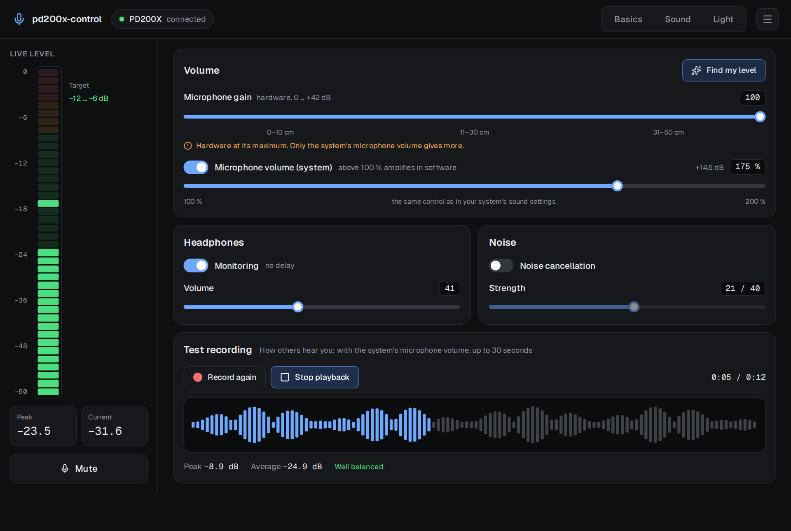

# pd200x-control documentation

pd200x-control controls the **Maono PD200X and PD200XS** USB microphones on Linux. MAONO's own app,
MAONO Link, runs on Windows only; pd200x-control does the same on Linux and adds what Linux users
need with a quiet dynamic microphone: a live level meter, a test recording that sounds like what
others hear, and a level finder that sets the gain and the system's microphone volume for you.

Also as a website with search: **https://firsttris.github.io/pd200x-control/**

| | |
|---|---|
| [Installation](installation.md) | AppImage, .deb, .rpm, Flatpak, the CLI, the udev rule, building from source |
| [The app](app.md) | every page: basics, sound, light, the menu and the tray |
| [A quiet microphone](quiet-microphone.md) | why the PD200X is quiet on Linux and how to get a good level |
| [Command line](command-line.md) | every `pd200x` command |
| [FAQ and troubleshooting](faq.md) | short answers and what to do when something does not work |
| [How it works](how-it-works.md) | the USB protocol, PipeWire, what is stored where, the architecture |
| [Development](development.md) | setup, `just` recipes, tests, the mock backend, screenshots, releases |

## In one minute

- **Everything MAONO Link sets, on Linux.** Gain, mute, headphone monitoring and volume, noise
  cancellation and its strength, the eight EQ profiles of the microphone, a 7-band EQ (five
  parametric bands, high-pass, low-pass), compressor, limiter, ring light colour, brightness and
  "light off while muted".
- **Reads what the microphone has.** The app asks the microphone for its settings when it is plugged
  in, so it shows the real state, also after you changed something with MAONO Link on Windows or
  with the knob on the microphone.
- **Made for quiet dynamic microphones.** The PD200X is a dynamic microphone; over USB it is quiet
  even at full gain. pd200x-control shows where your voice peaks, lets you raise the system's
  microphone volume above 100 % and finds the right setting from five seconds of speech.
- **Hear what others hear.** The test recording comes from PipeWire, like Discord, OBS or a browser
  would get it, including the system volume, which the microphone's own headphone monitoring does
  not include.
- **Nothing in the background.** The microphone keeps its settings itself; the app can be closed
  and everything stays as it is. There is no daemon and no cloud.
