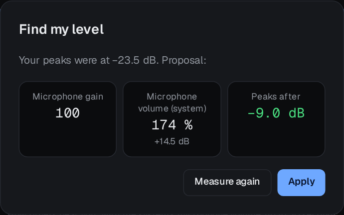
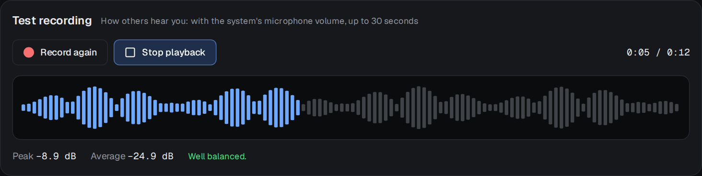
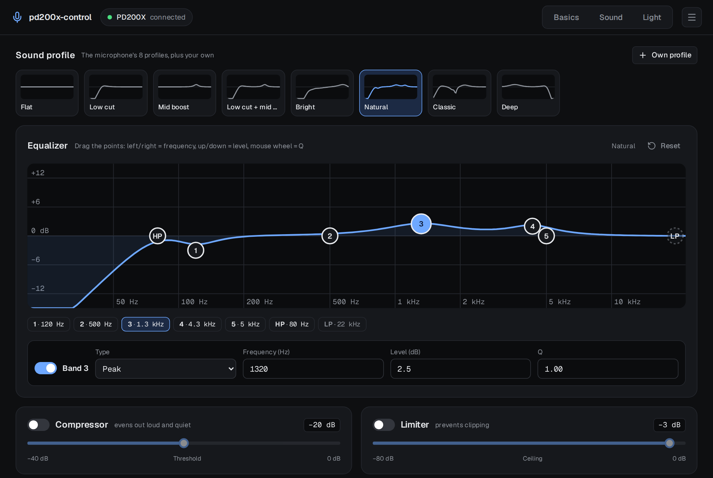
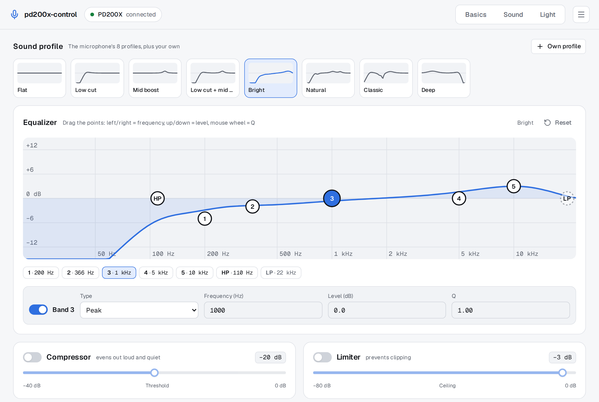
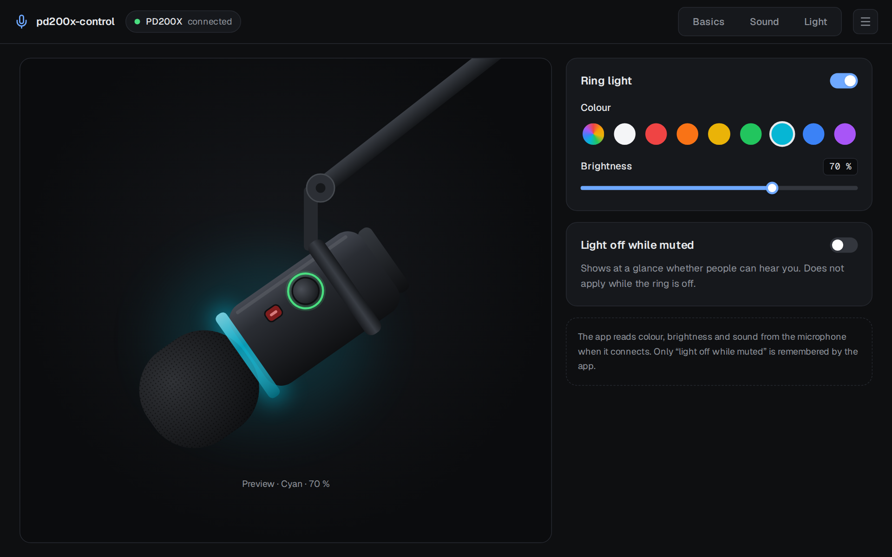

# The app

Three pages, switched at the top: **Basics**, **Sound** and **Light**. The chip next to the name says
whether the microphone is connected. Plug it in at any time; the app finds it within a second and
reads its settings.

Changes go to the microphone at once, and it keeps them itself, also without the app and after
unplugging.

## Basics

**Live level** (left): the level the microphone reports, about 18 times a second, in dBFS. The green
marker is the peak of the last one and a half seconds. Speech peaks belong in the target zone,
−12 to −6 dB: loud enough for every call and recording, with room before it clips.

**Mute**: the same as the button on the microphone; its LED turns red.

**Microphone gain** is the preamp in the microphone, 0 to 100 (about 0 to +42 dB). The distances
under the slider are MAONO's rule of thumb: the closer you speak, the less gain you need. At 100 the
app reminds you that only the system volume gives more.

**Microphone volume (system)** is the volume of the microphone's input in PipeWire, the same control
your desktop's sound settings show (KDE, GNOME, …). Above 100 % it amplifies in software; 175 % is
+14.6 dB. Change it here or there, both show the same value. See
[A quiet microphone](quiet-microphone.md).

**Protect from apps**: Teams, Slack and browsers (WebRTC's automatic gain control) turn the system
microphone volume down during a call and leave it there, so after a call you are quiet again
everywhere else. With this switch on they cannot change it any more; they adjust your level inside
the call as before. The control in the system's sound settings cannot change it then either, only
this app. It writes `~/.config/pipewire/pipewire-pulse.conf.d/90-pd200x-control.conf` and restarts
`pipewire-pulse`, so sound stops for a moment when switching; the app asks first. Restart running
browsers and call apps (Teams, Slack, Discord) once afterwards, or they will not find the microphone.

**Find my level**: speak for five seconds the way you usually do. The app measures your peaks and
proposes gain and system volume so they land near −9 dB. It raises the hardware gain first (it adds
less noise) and only then the system volume. Nothing changes until you press **Apply**.

**Headphones**: *Monitoring* routes the microphone straight to the headphone jack on the microphone,
without delay; *Volume* is the headphone level (the knob on the microphone changes it too). The
switch on the bottom of the microphone turns monitoring on and off as well.

**Noise**: the microphone's own noise cancellation and its strength, 0 to 40.

### Test recording

Records up to 30 seconds and plays it back on your normal output. The recording comes from PipeWire,
so it contains the system volume and sounds like what others get in Discord, OBS or a browser. The
microphone's own monitoring cannot do that: it comes from the microphone before the computer.

After recording you see the peak and the average in dB and a short verdict: *rather quiet*, *well
balanced* or *very loud*. The waveform is scaled to the loudest part, so quiet recordings show their
shape too. The recording is a temporary file that is deleted when the app quits.

## Sound

**Sound profile**: the eight profiles MAONO Link offers (Flat, Low cut, Mid boost, Low cut + mid boost,
Bright, Natural, Classic, Deep), each with its curve, and your own profiles. A click sends it to the
microphone. When the app connects, it recognises which profile the microphone has.

**Own profile** saves the current EQ under a name. Hover over an own profile to rename or delete it.

**Equalizer**: the curve is computed from the bands the way the microphone's DSP applies them. Drag a
point: left and right changes the frequency, up and down the level; the mouse wheel changes the Q.
Arrow keys do the same when a point has the focus. Below the graph, pick a band and type exact
values: type (peak, low shelf, high shelf), frequency, level and Q. HP and LP are the high-pass and
low-pass filters; only their frequency can be changed. Once you change a band, the EQ is a
"custom setting"; **Reset** then sets Flat (on a profile it sends the profile again).

**Compressor** evens out loud and quiet; **Limiter** stops peaks above its ceiling. Both take a
threshold in dB, like in MAONO Link.

The app follows the system's light or dark theme.

## Light

The ring light on or off, nine colours (including a rainbow) and the brightness. **Light off while
muted** turns the ring dark whenever the microphone is muted, so you see at a glance whether people
can hear you.

## Menu

- **Send sound and light again when plugged in**: off by default, because the microphone keeps its
  settings. Turn it on if yours forgets them; the app then sends the EQ, compressor, limiter and
  light it last set whenever the microphone is plugged in.
- **Language**: like the system, German or English.
- **About**: version, license and source.

## Tray

Where the desktop has a tray, the app adds an icon with **Toggle mute**, **Open window** and
**Quit**. Closing the window then keeps the app in the tray; quit it from there.
