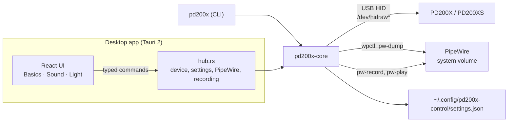

# How it works

## The pieces

- **`crates/core`** is the logic: the USB protocol, the live level, the system volume, the
  calibration, the recording analysis and the settings. Most of it is pure functions with tests; the
  hardware and the programs it runs are behind small traits, so the tests use a simulated microphone
  and fake programs.
- **`crates/cli`** is the `pd200x` command, a thin layer over the core.
- **`app/src-tauri`** exposes the core to the frontend as typed Tauri commands (tauri-specta writes
  `app/src/lib/bindings.ts`), watches for the microphone, and adds the tray.
- **`app/src`** is the React frontend: TanStack Router and Query, Tailwind, components in the
  shadcn/ui style, texts in German and English through Paraglide JS. Outside Tauri it runs against an
  in-memory mock backend.

## The USB protocol

The microphone is a USB audio device plus a HID interface for its settings (`352f:0104`). The app
writes and reads that HID interface through `/dev/hidraw*` – no driver, no libusb, no libudev.

Every setting is a 16-bit **register**. A packet of 65 bytes either writes a value
(`4B C4 0B 00 00 03 <register> <value> <checksum>`) or asks for one (`… 09 00 00 04 <register>`); the
microphone answers queries with the same layout. The checksum is the negated sum of the bytes. The
microphone also sends its level on its own, register `0x2034`, about 18 times a second; that is the
live meter.

| Registers | Meaning | Encoding |
|---|---|---|
| `0x2022` | mute | 0/1 |
| `0x2023` | gain | 0–100 |
| `0x2026`, `0x2027` | compressor on, threshold | 0/1, `2000 + dB × 10` |
| `0x202C`, `0x202D` | limiter on, threshold | 0/1, `2000 + dB × 10` |
| `0x2030` | headphone volume | 0–100 |
| `0x2031`, `0x2070` | monitoring (written together) | 2000/3000, 0 = on |
| `0x2034` | level (sent by the microphone) | `2000 + dB × 10` |
| `0x2036`–`0x2039` | light on, brightness, colour, linkage | 0/1, 0–100, 0–8, 0/1 |
| `0x203A`, `0x203B` | noise cancellation on, strength | 0/1, `(s + 120) × 10` |
| `0x204D`… | 7 EQ bands × (on, type, Hz, gain, Q) | gain `2000 + dB × 10`, Q × 100 |

The packet layout, the registers and the eight EQ presets were worked out by
[pd200x](https://github.com/advnpzn/pd200x) (advnpzn, MIT) from USB captures of MAONO Link.
pd200x-control adds reading back the EQ, dynamics and light (the microphone answers those queries
too) and detects which preset the microphone has. The linkage register reads back values that do not
match what was written, so the app remembers that one itself.

## The system microphone volume

The PipeWire source of the microphone is found with `pw-dump` (or `wpctl status -n` where `pw-dump`
is missing) by its name, `alsa_input.usb-352f_PD200X…`. `wpctl set-volume <id> <volume>` sets it.
PipeWire volumes are cubic: 1.75 means an amplitude of 1.75³ ≈ 5.36, that is +14.6 dB, which the
desktops show as 175 %. WirePlumber keeps it across restarts.

## The level finder

From five seconds of the microphone's level reports the app takes the 98th percentile as the speech
peak (a single bump or click does not count). The difference to −9 dB goes to the hardware gain
first (0.42 dB per step, up to 100) and the rest to the system volume (up to +18 dB); when it is too
loud, the system volume comes down first.

## The test recording

`pw-record --target <PD200X source> --format s16 --rate 48000 --channels 1` writes a WAV file to the
temporary folder, stopped after 30 seconds at the latest with SIGINT, so the WAV header is complete.
The core reads it back for the peak, the RMS average and a 120-point waveform. `pw-play` plays it on
the default output.

## What is stored where

| Where | What |
|---|---|
| The microphone | everything it can be set to; it keeps it without power |
| WirePlumber | the system microphone volume |
| `~/.config/pd200x-control/settings.json` | own EQ profiles, the last EQ, dynamics and light the app set, "light off while muted", the options |
| The temporary folder | the test recording, until the app quits |
